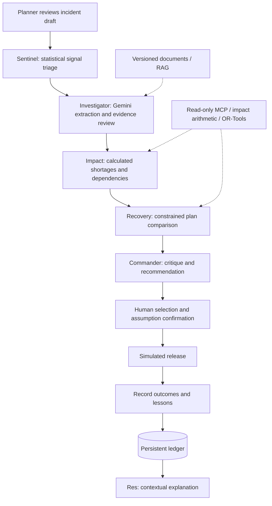

# ResilientOps

**AI-assisted supply-chain disruption analysis and recovery planning.**

**[Live application on Google Cloud Run](https://resilientops-uqjrybm5nq-el.a.run.app/app)** · [Deployment guide](DEPLOY_CLOUD_RUN.md) · [Architecture](docs/architecture.md) · [Google sign-in setup](docs/google-signin.md)

## Project summary

Supply-chain planners must connect disruption notices to inventory, production demand and available recovery options before shortages interrupt operations. ResilientOps combines five independently reasoning Gemini agents with evidence retrieval, statistical monitoring and constrained optimization to produce a reviewable impact assessment and recovery plan. The planner selects a plan, authorizes simulated execution and records outcomes in one connected workspace.

This prototype uses **synthetic operational data and simulated execution**. It does not place real purchase orders, confirm real deliveries or claim measured business savings.

## Google technology implementation

| Technology | Role in this application | Implementation |
| --- | --- | --- |
| **Vertex AI / Gemini** | `gemini-3.5-flash` is configured for the agents and Res chat, using the `global` location. Model IDs and location are configurable. SDK clients explicitly use `vertexai=True` and Application Default Credentials. | [Configuration](src/resilientops/config.py) |
| **Google ADK** | Five separate `LlmAgent` nodes retrieve evidence, invoke constrained tools and submit structured reviews: Sentinel, Investigator, Impact, Recovery and Commander. | [ADK graph](src/resilientops/agents/google_adk.py), [review contracts](src/resilientops/agents/reasoning.py) |
| **Gemini extraction** | Investigator requires structured extraction, with source validation before extracted facts change planning inputs. Conflicting or unsupported evidence can stop analysis. | [Gemini adapter](src/resilientops/adapters/gemini.py), [grounding](src/resilientops/services/grounding.py) |
| **Res chatbot** | Explains the current incident and plans using server-loaded context and retrieved documents. It cannot approve or execute a plan. | [Chat service](src/resilientops/services/chat.py) |
| **Cloud Run** | Hosts a Python 3.13 FastAPI container and the active `web2` frontend. | [Dockerfile](Dockerfile), [deployment script](deploy/cloud-run.sh) |
| **Cloud SQL PostgreSQL** | Persists incidents, traces, inventory and simulated actions with transactional updates. Local development can use SQLite; Cloud Run requires PostgreSQL. | [Storage](src/resilientops/storage.py), [database guide](docs/cloud-sql.md) |
| **Secret Manager / IAM** | Supplies database, OAuth and session secrets to Cloud Run. The attached runtime service account authenticates to Vertex AI and Cloud SQL without a checked-in key. | [Deployment settings template](deploy/cloud-run.env.example) |
| **Google OAuth** | Provides browser sign-in independently of server-side Vertex credentials. | [Authentication](src/resilientops/auth.py) |

The default RAG implementation is **local lexical retrieval over versioned documents**, not managed vector search. Optional [Vertex Vector Search](src/resilientops/adapters/vertex.py) and [BigQuery](src/resilientops/adapters/bigquery.py) adapters are included; their presence does not mean they are enabled. This configuration uses Vertex AI, not Google AI Studio. Verify model access and availability in your project before running.

## End-to-end flow



Sentinel supports external, internal and market disruption signals. An anomaly triggers investigation; it does not establish causality. Deterministic tools validate inventory, daily demand, source qualification, arrival timing, capacity, minimum-order and pack-size constraints. LLM recommendations cannot bypass those checks. Relevant data or constraint changes invalidate stale plans.

## Reviewer walkthrough

1. Open the live app and sign in with Google.
2. Review a supplied incident or create a draft from a known shipment.
3. Choose **Assess Impact**; inspect source evidence, agent reviews and calculated shortages.
4. Open **Recovery Planning** and compare the feasible plans generated for that incident.
5. Review the selection rationale and assumptions before confirming a plan. Any release is simulated.
6. Ask **Res** for an explanation, download impact/recovery reports, and use **Learning** to record outcomes.

Analysis may take several minutes. Infeasible cases, ambiguous evidence and provider failures remain visible rather than being silently replaced with successful results. Learning records outcomes and lessons; it does not automatically retrain a model.

## Local installation

### 1. Clone and install dependencies

Python 3.13 and [uv](https://docs.astral.sh/uv/) are the tested development setup. Replace the placeholder URL with this project's actual public GitHub URL:

```sh
git clone https://github.com/YOUR_ORGANIZATION/YOUR_REPOSITORY.git
cd YOUR_REPOSITORY
uv sync --frozen --all-extras
cp .env.example .env
```

Publish the extracted `resilientops/` contents as the repository root: `README.md`, `Dockerfile`, `pyproject.toml`, `src/` and `web2/` should be top-level entries. No frontend build step is required.

### 2. Configure Vertex AI

Use a billing-enabled Google Cloud project, enable Vertex AI, and authenticate an identity with permission to invoke its models:

```sh
gcloud config set project YOUR_PROJECT_ID
gcloud services enable aiplatform.googleapis.com
gcloud auth application-default login
gcloud auth application-default set-quota-project YOUR_PROJECT_ID
```

Set these values in the ignored `.env` file:

```dotenv
RESILIENTOPS_MODEL_BACKEND=vertex
GOOGLE_CLOUD_PROJECT=YOUR_PROJECT_ID
GOOGLE_CLOUD_LOCATION=global
RESILIENTOPS_AGENT_MODE=google
RESILIENTOPS_EVIDENCE_MODE=gemini
RESILIENTOPS_MODEL=gemini-3.5-flash
RESILIENTOPS_CHAT_MODEL=gemini-3.5-flash
RESILIENTOPS_KNOWLEDGE_MODE=local
RESILIENTOPS_ERP_MODE=local
RESILIENTOPS_MAX_LLM_CALLS=80
RESILIENTOPS_ANALYSIS_TIMEOUT=1800
RESILIENTOPS_LLM_REQUESTS_PER_MINUTE=4
```

Use model IDs available to your project and reverify the workflow if changing models. The **80-call ceiling** and **1,800-second timeout** bound an assessment; they do not force that many calls or guarantee completion. Quotas and provider errors can still stop analysis. Earlier verification notes in the deployment guide describe the previous 40-call configuration.

### 3. Configure Google sign-in

Create a **Web application** OAuth client and register this exact **Authorized redirect URI**:

```text
http://127.0.0.1:8000/auth/google/callback
```

Generate a session secret locally:

```sh
uv run python -c 'import secrets; print(secrets.token_urlsafe(48))'
```

Set all three identity/session values together in `.env`:

```dotenv
RESILIENTOPS_GOOGLE_CLIENT_ID=YOUR_WEB_CLIENT_ID
RESILIENTOPS_GOOGLE_CLIENT_SECRET=YOUR_WEB_CLIENT_SECRET
RESILIENTOPS_SESSION_SECRET=YOUR_GENERATED_SESSION_SECRET
RESILIENTOPS_PUBLIC_URL=http://127.0.0.1:8000
```

Add reviewers as OAuth test users if the audience is restricted. Browser sign-in does not authenticate the server to Vertex AI. For local-only testing without sign-in, omit all three identity/session values and bind only to localhost.

### 4. Run

```sh
.venv/bin/resilientops --env-file .env init
.venv/bin/resilientops --env-file .env serve --host 127.0.0.1 --port 8000
```

Open **http://127.0.0.1:8000/app**. API documentation is at `/docs`; health is at `/health`. Runtime state is stored in ignored `var/operational.db` unless PostgreSQL is configured.

For an offline deterministic baseline without live GenAI:

```sh
RESILIENTOPS_AGENT_MODE=local RESILIENTOPS_EVIDENCE_MODE=rules .venv/bin/resilientops demo
```

## Deploy to Google Cloud Run

Follow [DEPLOY_CLOUD_RUN.md](DEPLOY_CLOUD_RUN.md) for required APIs, runtime IAM, Cloud SQL, and Secret Manager setup. Use resource names for your own environment:

```sh
cp deploy/cloud-run.env.example deploy/cloud-run.env
# Edit the project, region, instance, service account and secret names.
set -a
source deploy/cloud-run.env
set +a
bash deploy/cloud-run.sh
```

The deployment script builds the Dockerfile using Cloud Build, attaches Cloud SQL, references secrets and sets the service's public URL. The included `deploy/cloud-run.env` contains deployment-specific resource names, not secret values; the example file is the portable configuration template.

Register the exact hosted callback in Google Auth Platform:

```text
https://resilientops-uqjrybm5nq-el.a.run.app/auth/google/callback
```

Use the runtime service account for Vertex ADC and Secret Manager for credentials. Do not commit personal ADC, OAuth downloads, passwords or session secrets. This archive does not contain runtime incident history. [Database migration](docs/cloud-sql.md) is explicit and separate.

The prototype uses one warm instance and always-allocated CPU for in-process analysis, which incurs ongoing charges. Background tasks are not a durable queue; avoid redeployment during analysis. Completed state persists in PostgreSQL, but interrupted analysis can require retry.

**Deployment verification:** an existing live URL does not prove this updated archive is deployed. Redeploy these changes, confirm `/health` reports PostgreSQL, and verify reviewer sign-in, all five agent reviews, plan selection, Res, report downloads and record persistence before submission.

## Repository structure

```text
src/resilientops/    Backend, five agents, Google integrations, analytics and tools
web2/               Active frontend and connected workflow UI
resilientops_data/   Synthetic operational JSONL, knowledge and disruption scenarios
data/               Legacy regression fixtures and evaluation labels
tests/              Domain, workflow, integration and authentication tests
scripts/            Data preparation, evaluation and administrative utilities
deploy/             Cloud Run deployment script and resource settings
docs/               Architecture, API, database and setup documentation
Dockerfile          Google Cloud Run container
.env.example        Non-secret application settings template
pyproject.toml      Python dependencies and CLI entry points
uv.lock             Locked dependency resolution
```

The application reads operational JSONL inputs. The optional duplicate `resilientops.sqlite` source export is not included in this archive; it is not required by the runtime adapter. Keep `data/`, which is used by regression tests.

## Validation

```sh
uv run pytest -q
```

The tests use isolated state and mocked providers where appropriate. They verify calculations and workflow behavior, not live model availability or production readiness. PostgreSQL integration tests need a disposable `RESILIENTOPS_TEST_POSTGRES_URL`; otherwise they skip. Historical evaluation results under `docs/evaluation/` describe their recorded datasets and modes, not a universal accuracy score.


This is a single-tenant prototype with some publicly readable synthetic endpoints. It has no real purchasing integration, no calibrated disruption-probability claim, no measured business-savings claim and no formal accessibility certification yet.
