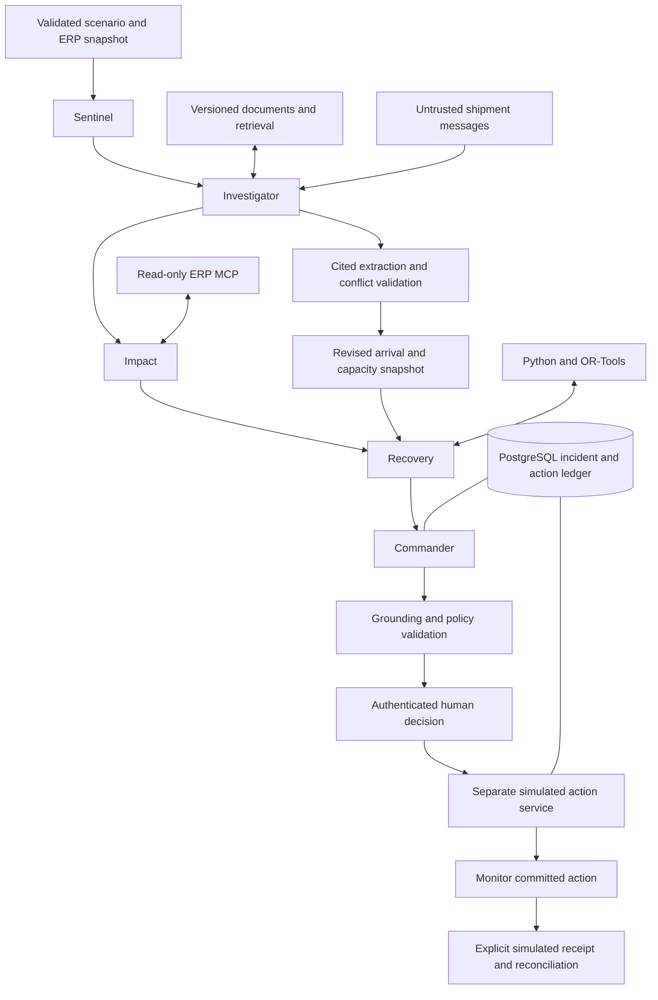

# Architecture

The domain workflow owns transitions, evidence, policies, plan versions and approvals. The LLM can invoke only the tools assigned to its role. An ADK graph sequences the five agents in Google mode; local mode exercises the same domain operations directly.

The active UI wraps this five-agent pipeline in explicit draft review, planner
selection, approval, monitoring and closure gates. See the [complete diagram
workflow](workflow-diagram.md) for both replanning loops and the active operational
simulation policy. The graph above describes the inner assessment/action pipeline.

## Role boundaries

| Role | Domain tool | Additional Google-mode tools |
| --- | --- | --- |
| Sentinel | `run_sentinel` | MCP `get_supplier_history` |
| Investigator | `run_investigator`: retrieve policy, interpret and reconcile shipment messages | `search_documents` |
| Impact | `run_impact` | MCP `get_inventory`, `get_dependencies` |
| Recovery | `run_recovery` | MCP `get_recovery_options` |
| Commander | `run_commander` | `get_validated_results` |

There is no agent execution or approval tool. The action service is invoked through the authenticated API after an explicit human decision. The required role is calculated by code, not accepted from model output or an HTTP body.

## Substantive model contribution

The Investigator calls the structured extraction adapter on active unstructured shipment messages. It maps known booking/entity references to an option, extracts the currently confirmed arrival and available quantity, cites exact passages and flags uncertainty. A strict rules parser is available for offline comparison; it does not claim semantic reasoning.

Reconciliation requires every active message to be accounted for. Unknown entities, missing fields, unsupported values, invented citations, capacity increases above the ERP ceiling, and conflicts block downstream stages. No partial changes are applied when review is required. Only arrival day and reduced capacity can change; costs, qualification, inventory and approval policy remain controlled by code and ERP inputs. Exact quote/value checks establish source anchoring, not semantic entailment or sender authenticity.

`input_snapshot` preserves the original planning inputs and the source history. `snapshot` contains reconciled inputs used by the optimizer and bound to the plan hash. A new authenticated source update returns the workflow to analysis, resets approval and increments the revision. Supersession is explicit analyst metadata; the model cannot silently select the latest report as authoritative. A blocked Investigator result remains persisted for review, and later tools cannot bypass it.

Model commentary is stored separately from validated business results. The dashboard displays citations and deterministic comparisons regardless of model commentary availability. Public explanations are labeled; thought parts are excluded.

## Analytical methods

- **Detection:** fit Isolation Forest on observations preceding the latest one. Combine its anomaly score, an EWMA deterioration signal and event severity using documented heuristic weights. Scores are not calibrated probabilities.
- **Impact:** calculate usable stock as on-hand minus reserved minus quality hold. Net cumulative daily demand against usable supply. BFS propagates dependency exposure, with cycle protection. Financial exposure is an explicit synthetic unit-shortage assumption, not a revenue forecast.
- **Uncertainty:** 1,000 seeded samples from the scenario's triangular delay distribution, using average demand. These are conditional simulation results, not trained predictions. Dated demand drives the authoritative feasibility calculation.
- **Recovery:** OR-Tools SCIP integer quantities and binary option-selection variables minimize procurement/transport costs. Every day's cumulative demand must be covered. Shared source limits prevent multiple options from each consuming the same safety-stock-adjusted balance. Solver status distinguishes optimal, feasible and infeasible. The bounded candidate set and demand horizon define the scope of optimality.
- **Grounding:** factual decision fields refer to exact fields in stored tool evidence. Schema checks alone do not establish truth. Free-form model commentary is not promoted into executable fields or claimed to be semantically verified.
- **Business comparison:** calculate cumulative shortages with no action and with the proposed recovery. Financial exposure uses an explicit synthetic per-short-unit assumption; net benefit subtracts recovery cost. An independently checked original-ERP plan demonstrates when new evidence makes the earlier plan infeasible. These are conditional planning metrics, not observed savings.

## State and concurrency

`DETECTED → ANALYZING → AWAITING_APPROVAL → APPROVED → MONITORING → RESOLVED`

Rejected decisions, missing evidence, infeasible plans and unexpected failures have separate states. A no-action result closes only the planning assessment and records that reason. Reanalysis refreshes an unexecuted snapshot, increments the plan version and clears approval.

- Unique event IDs deduplicate ingestion.
- A persisted analysis lease prevents duplicate workers from running the same incident.
- Stage outputs are persisted independently. A replacement worker can reuse completed stages after lease expiry.
- Approval binds actor, role, policy version, exact plan hash and planning-data freshness.
- Plan hashes and snapshot hashes are checked again at execution.
- PostgreSQL advisory transaction locks serialize capacity checks, reservations, action records and state changes across workers. Local SQLite uses `BEGIN IMMEDIATE` for the same guarantees.
- A unique plan hash makes repeated execution return the committed action.
- A timeout after a successful commit can be reconciled by retrying with the same plan hash.
- Simulated transfers reserve source stock at commit; explicit receipt moves on-hand balances. The receipt path is also idempotent.

## Retrieval

The small demo corpus is already split into bounded document chunks. Local mode uses lexical overlap with supplier/active filters. Google mode embeds the query, searches the configured index, and resolves IDs back to known document chunks. Both supplier-specific audits and globally applicable active policies are queried.

The fixture policy IDs bind to the demo's coded policy version. Changing policy text does not change executable rules. Administrators must update and test code and policy versions together. Full enterprise document ingestion, tenant-level ACL enforcement, and semantic claim entailment evaluations are future production work.

## External evidence

`tools/signals.py` reads NASA EONET and Open-Meteo explicitly, with timeouts, provenance, and independent source-error reporting. The raw collector is separate from the seeded scenario. Connecting it to continuous incident creation requires a supplier geospatial exposure model and corroborated shipment data; proximity alone must not be turned into an exact delay.

## Verification performed

The local test suite covers deterministic correctness and state/action boundaries. ADK is exercised with a scripted model and real MCP subprocesses. Live cloud behavior is not represented as verified without credentials and provisioned resources.

## Five Gemini reasoning agents (October 2026 update)

The configured application uses five distinct Google ADK `LlmAgent` instances:
Sentinel, Investigator, Impact, Recovery and Commander. They share a Gemini model
family but have separate role instructions, tool scopes, retrieval queries and
structured assessments. The orchestrator preserves their dependency order; this
is not five unrelated parallel calls or five separately trained models.

Each role reads incident context, retrieves active supplier/global evidence (RAG),
runs its validated domain tool, and submits a cited assessment containing a summary,
uncertainties, next action and continue/needs-review verdict. Recovery/Commander can
recommend only an existing candidate ID. Missing assessments, unknown citations,
missing retrieval, or review-required verdicts prevent downstream progression.
Citations establish reference provenance, not semantic truth. Planner selection and
simulated release remain explicit user actions.

Investigator always performs Gemini structured extraction of incident/document facts
in Google mode, including incidents without shipment messages. Shipment updates get
an additional Gemini extraction followed by deterministic exact-span/entity/date/
quantity checks and conflict reconciliation. There is no rules fallback in Google
mode. Local/rules execution remains explicitly available for offline regression and
baseline evaluation; it is not the configured application workflow.

RAG currently uses local lexical retrieval of versioned active documents. Vertex
vector retrieval is still an optional configured adapter; no external vector index
is required or claimed. Each agent's retrievals and structured assessments are saved
per incident revision and displayed in the UI. Replanning resets them.

Gemini API-key and Vertex/ADC authentication are supported. A shared process-level
request pacer covers ADK, extraction and Res. The application defaults to four model
requests per minute with bounded transient-error retries, reflecting the observed
free-tier quota; a five-agent assessment can therefore take several minutes. Adjust
`RESILIENTOPS_LLM_REQUESTS_PER_MINUTE` to the actual project quota and
`RESILIENTOPS_ANALYSIS_TIMEOUT` accordingly. This single-process prototype does not
coordinate quota budgets across multiple server replicas.

Validation status: the mocked ADK integration runs all five agents and their real
domain tools with required retrieval and cited assessments. Separate live requests
verified Sentinel reasoning and Gemini source extraction. A complete live run is
not yet verified: the configured provider exhausted its 20-request daily quota.
See `docs/evaluation/llm-workflow-results.json`. Raising request pacing does not
solve a daily quota; wait for reset or configure sufficient project quota.
