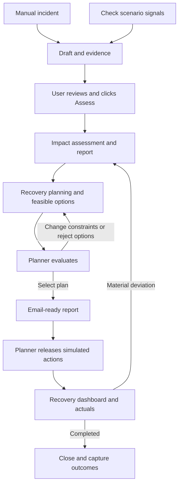

# Diagram workflow

The active `web2` dashboard follows `../../mermaid-diagram.png`, with the requested
local-simulation change: the approver gate is removed.
The web2 navigation, map, logo, theme and layout are used; connected views are
implemented in `web2/workflow-ui.js`. `services/diagram.py` owns the human gates and
revision loops around the existing five-agent assessment pipeline.

| Diagram node / branch | Implementation |
| --- | --- |
| User manually enters incident | New incident form accepts a supported scenario or known outstanding shipment plus delay and evidence. |
| Application detects and pre-fills incident | Empty-workspace initialization or Check scenario signals scans SCN_001–SCN_003 for shortages and creates deduplicated drafts. This is a synthetic scenario scan, not a live feed. |
| Incident draft with details and evidence | Persistent DRAFT, editable before assessment; operator evidence is included in retrieval. |
| User reviews, edits and clicks Assess | Save draft, then Assess saved draft; revision checks prevent stale edits. |
| Impact Assessment / report | Sentinel → Investigator → Impact; daily shortages, affected entities and related allocated order value. Unmodeled financial loss remains unvalued. |
| Recovery Planning / feasible options report | Recovery generates a best plan and feasible single-source alternatives; deterministic validation checks each candidate. |
| Planner evaluates / selects plan | Selection requires rationale and acknowledgment of assumptions; selection makes the plan ready for release without approval. |
| Reject all or change constraints | Exclude sources, change budget/arrival deadline and replan; create a new revision, clearing old selection and approval. |
| Email-ready execution report | Exact revision, plan hash, allocations, estimated cost and evidence; downloadable `.eml`. No mail is sent. |
| Direct planner release | No approver gate in local simulation. Google sign-in identifies the planner; selection and release are separate actions. |
| Revise constraints | A reason is recorded and the incident returns to planning. |
| Release selected actions | Release checks exact plan hash, selection, planning-data freshness, capacity and inventory. |
| Recovery dashboard / actuals | Record cumulative recovery receipts and execution cost, plus incremental consumption and scheduled receipts. Updates are transactional and idempotent. |
| Material deviation → Impact Assessment | Explicit deviation, overdue outstanding recovery, or cost overrun cancels the unreceived remainder, releases reservations and re-assesses remaining demand using recorded actuals. Prior approvals are invalidated. |
| Completed → close / capture outcomes | Full recovery receipts lead to outcome review. Explicit closure records outcome, lessons and cost variance. No-action baseline also requires closure. |

## States and boundaries

The planning horizon remains 30 days. SCN_004–SCN_012 need additional modeling
and remain explicitly unsupported. Source records are immutable; runtime state
is isolated in `var/operational.db`. Actions and actuals are simulations, not ERP
transactions. Learning means persisted outcomes and lessons, not automatic model
training. Default agent mode is local deterministic orchestration; optional Google
ADK/Gemini execution needs its separate cloud configuration.

`tests/test_diagram_workflow.py` covers revision guards, selection, authorization,
rejection loops, constraints, partial receipts, retries, deviation reassessment,
closure and restart persistence. Browser verification exercises the full happy
path using an isolated database and checks desktop/mobile rendering.
